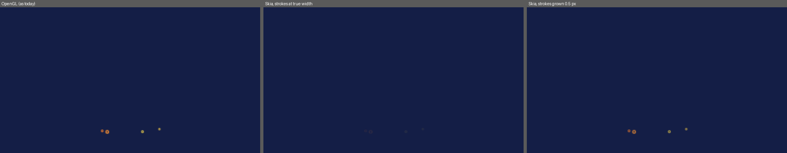
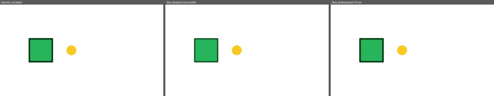
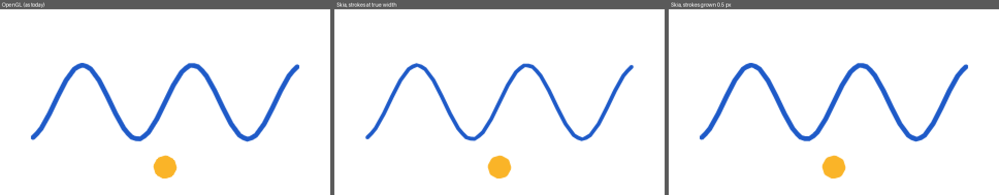
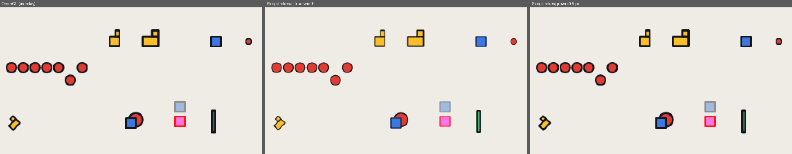
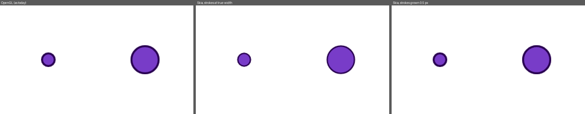
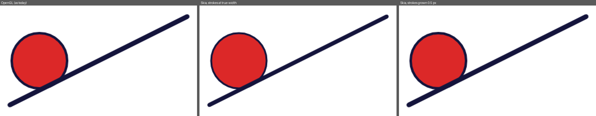
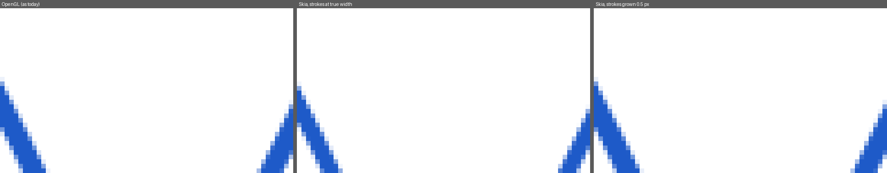
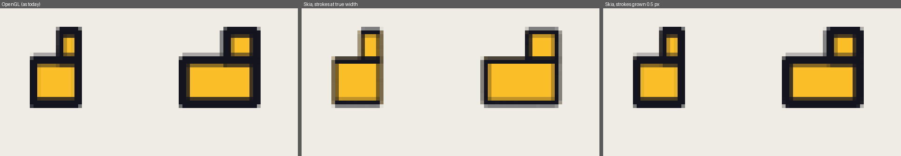
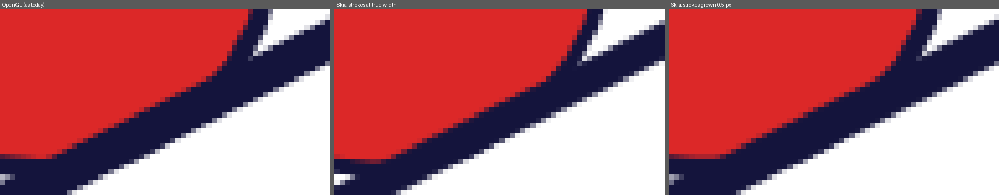

# 迁移第 2 步：笔触线重对照图（Q2）

**已决定（2026-11-09）：保持现在的线重**，即第 3 种，现在是默认值。这些图留作记录。

每张图从左到右是同一帧的三种渲染：

1. 今天的 OpenGL 渲染（基准）
2. Skia，笔触按几何上的真实宽度
3. Skia，笔触向外长出半个像素（今天的线重）

场景都是参考项目里的，320x180，第 1 帧。整帧的图放大了 2 倍，`zoom_` 开头的是局部放大 8 到 10 倍。区域在两种 Skia 渲染里都外扩了半个像素（Q1 已定）。

和 OpenGL 相比（叠在白底上，逐像素取最大通道差；"墨量"是整张图 alpha 的总和）：

| 场景 | 真实宽度：差超过 32 的像素 | 真实宽度：墨量 | 外扩半像素：差超过 32 的像素 | 外扩半像素：墨量 |
|---|---|---|---|---|
| vector_basic | 2.08% | -4.7% | 0.01% | +0.1% |
| pegbar_hierarchy | 0.80% | -2.6% | 0.01% | +0.1% |
| subxsheet | 0.95% | -3.9% | 0.01% | 0 |
| sound_column | 1.81% | -17.4% | 0.01% | +0.3% |
| stage_showcase | 3.23% | 背景不透明，量不出 | 0.08% | |
| particles_basic | 0.48% | 同上 | 0.10% | |

自己重渲：在带 Skia 的构建里给 tcomposer 设环境变量 `NEXTTOONZ_VECTOR_RASTERIZER=skia`，得到的就是第 3 种；要第 2 种再加 `NEXTTOONZ_STROKE_GROW=0`。

## 图

