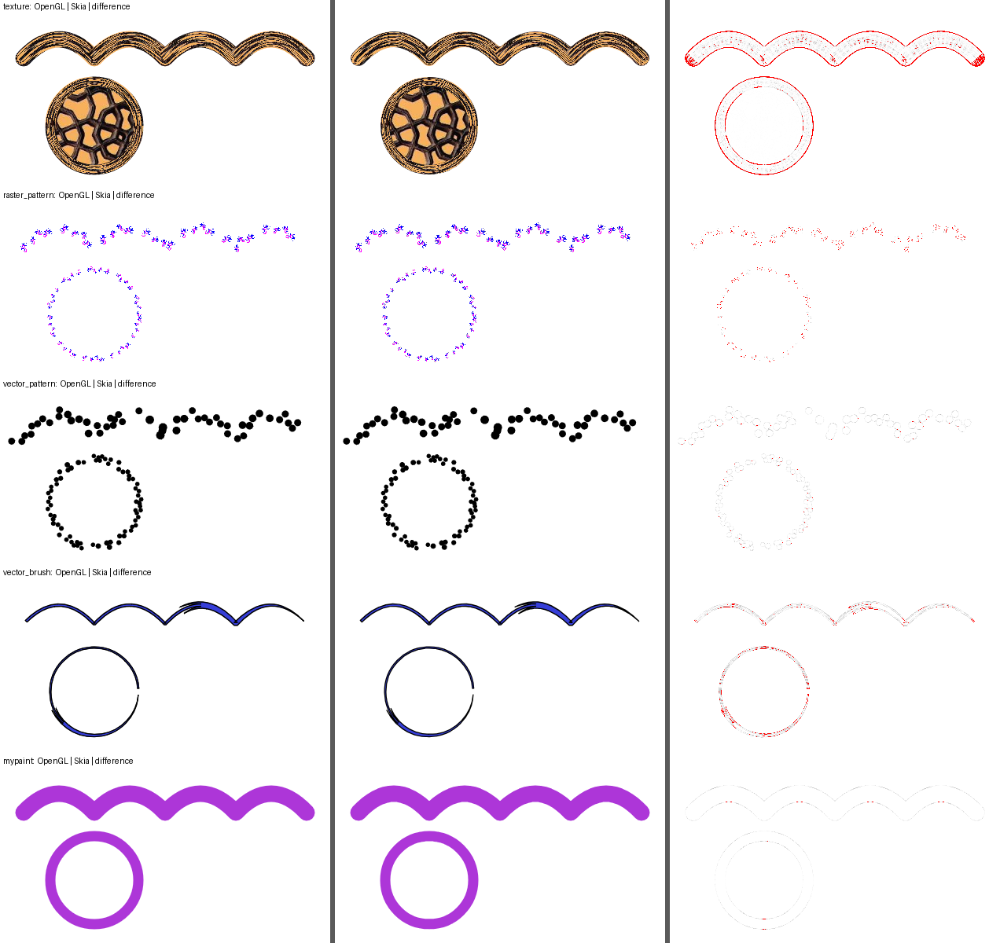

# 迁移第 3 步：五类样式的 OpenGL 与 Skia 对照

`step3_styles.png` 每一行是一种样式：左边是今天的 OpenGL 渲染，中间是 Skia，右边是两者的差（红色是相差超过 32 的像素，叠在白底上比）。每张图是一条波浪笔触加一个圆（贴图样式的圆是填充的）。

| 样式 | 差超过 2 | 差超过 32 | 墨量 |
|---|---|---|---|
| 贴图（TTextureStyle） | 7.19% | 1.81% | -2.9% |
| 栅格图案笔触 | 0.61% | 0.31% | +5.7% |
| 矢量图案笔触 | 2.17% | 0.06% | -0.4% |
| 矢量笔刷 | 2.78% | 0.35% | -2.6% |
| MyPaint 笔刷 | 1.36% | 0.02% | 0 |

栅格图案多出来的墨是有意没有重现的旧怪癖（旧代码在透明背景上把图案的 alpha 平方了一次），见 `doc/nexttoonz_canvas_ir.md` 5.6 节。

这些图是单独为每个样式画的：参考场景 `vector_styles` 的每一帧都混着还没迁移的样式，Skia 模式下整帧仍走 OpenGL。

## 图

