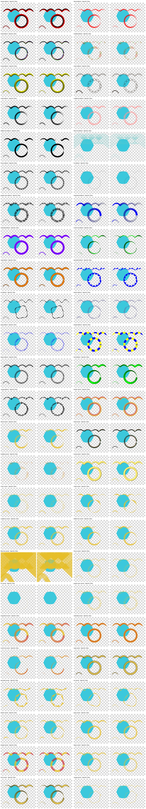
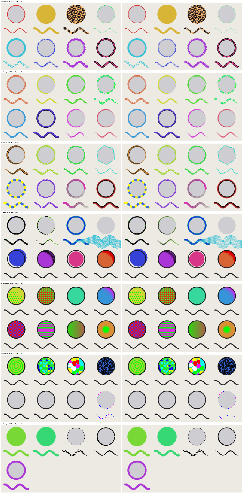

# 迁移第 5 步：笔触样式与整个场景的 OpenGL 与 Skia 对照

- `step5_stroke_styles.png`：colorfx 25 个笔触样式的 OpenGL 与 Skia 对照，每个样式两组参数。
- `step5_vector_styles_scene.png`：参考场景 `vector_styles` 整个场景 7 帧的 OpenGL 与 Skia 对照，第一次整帧用 Skia 渲。

数字见 `doc/nexttoonz_canvas_ir.md` 5.8 节。

## 图

