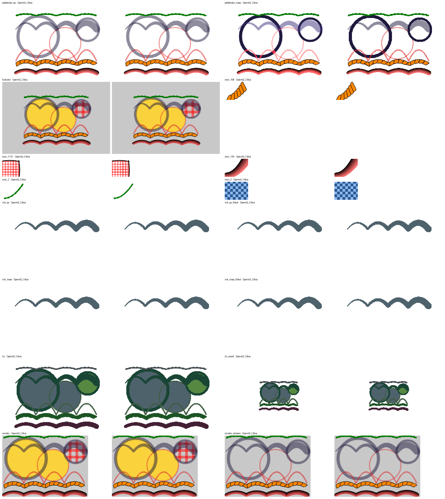
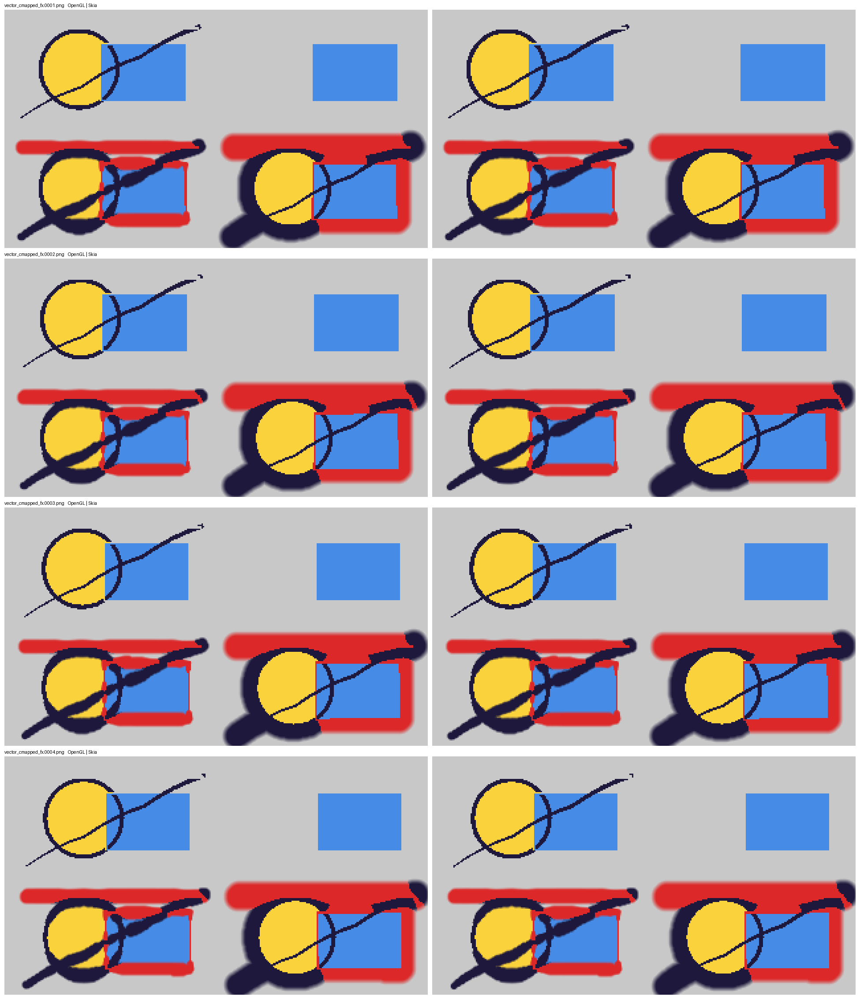

# 第 6 步对照图

- `step6_vector_cmapped_fx.png`：新场景 `vector_cmapped_fx` 的 4 帧，左 OpenGL 右 Skia（`NEXTTOONZ_VECTOR_RASTERIZER=skia`）。四个矢量层分别经过调色板滤镜（线）、调色板滤镜（区域并删去所有线）、calligraphic、outBorder，渲染时都先把矢量转成色指数栅格。
- `step6_functions.png`：第 6 步接上 Skia 的函数，同一张图分别经 OpenGL 和 Skia：转色指数栅格（`tzi`）、往色指数栅格加墨线并改色（`ink_*`）、往全彩栅格加笔触（`addstroke_*`）、转全彩（`fullcolor`）、`TVectorImage::render`（`render*`）、样式图标（`icon_<tag>`）。色指数图按"墨色乘以覆盖率、底下是颜料"着色，颜色是按编号随便配的。

## 图

