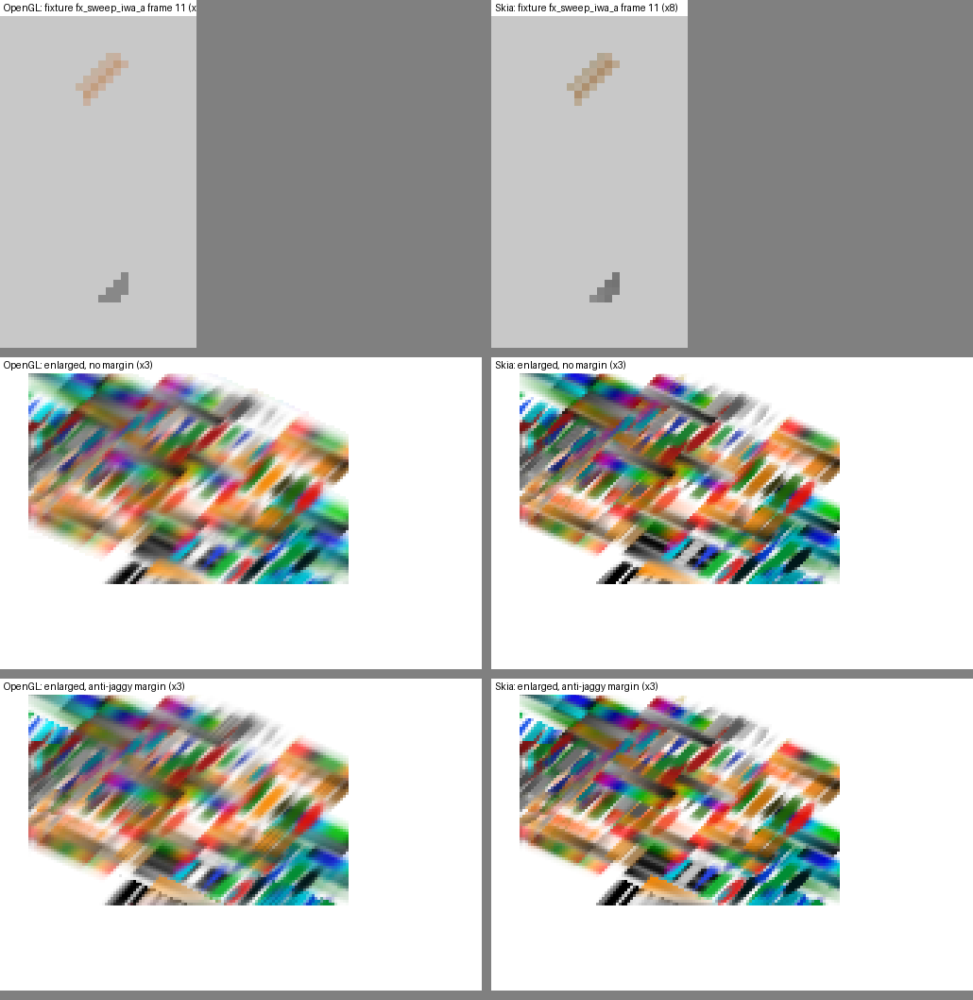
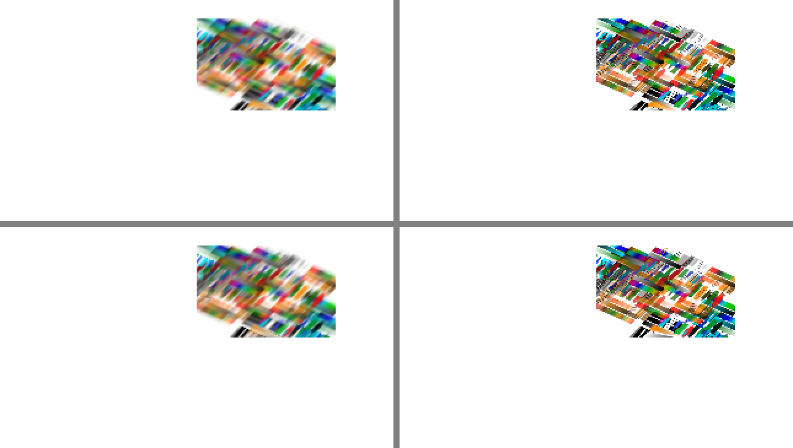
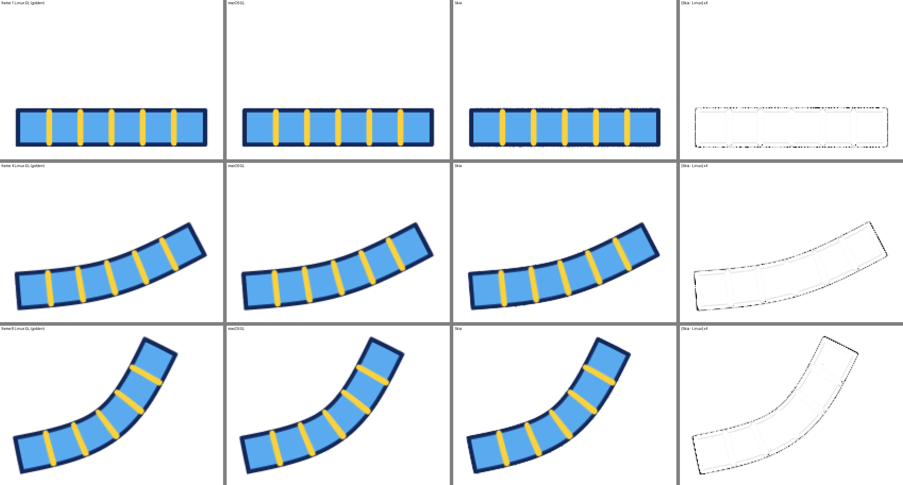

# 第 7 步对照图

- `step7_plastic.png`：`plastic_basic` 的第 1、4、8 帧（放大 3 倍）。从左到右：Linux 上 OpenGL 渲出的 golden 基线、本机 OpenGL（这个场景在本机 AMD 驱动上本来就过不了 golden）、Skia（`NEXTTOONZ_VECTOR_RASTERIZER=skia`）、Skia 与 Linux 基线按预乘值的差（放大 4 倍，越黑差得越多）。差别只在网格外边：OpenGL 沿外边多描一条一像素的平滑线；第 1 帧 Skia 上边那串浅点是变形后的顶点凸出了零点几个像素，OpenGL 不反走样地填三角形，看不出来。
- `step7_flowpaintbrush.png`：流动笔刷，左 OpenGL 右 Skia。第一行是 golden 场景 `fx_sweep_iwa_a` 第 11 帧里这个特效的那一小块（放大 8 倍，灰底）；下面两行是放大的场景，一个不带 anti-jaggy 边，一个带（放大 3 倍）。Skia 沿笔尖长度方向比 OpenGL 清楚一些：两边都用 mipmap，但选级别的规则不同。
- `step7_flowpaintbrush_without_mipmaps.png`：同样两个放大场景，Skia 那时还没有 mipmap（左 OpenGL 右 Skia）。这是 IR 加 mipmap 采样的原因。
- `flow_a.tnz`、`flow_b.tnz`：两个放大的场景，是参考项目 `fx_sweep_iwa_a.tnz` 改了流动笔刷的参数（密度 25x25、笔尖宽 0.15 到 0.3、长 0.3 到 0.6、范围 300x200；`flow_b` 开了 anti-jaggy）。要放进参考项目的 `scenes/` 里才能渲，看的是第 11 帧。

## 图

