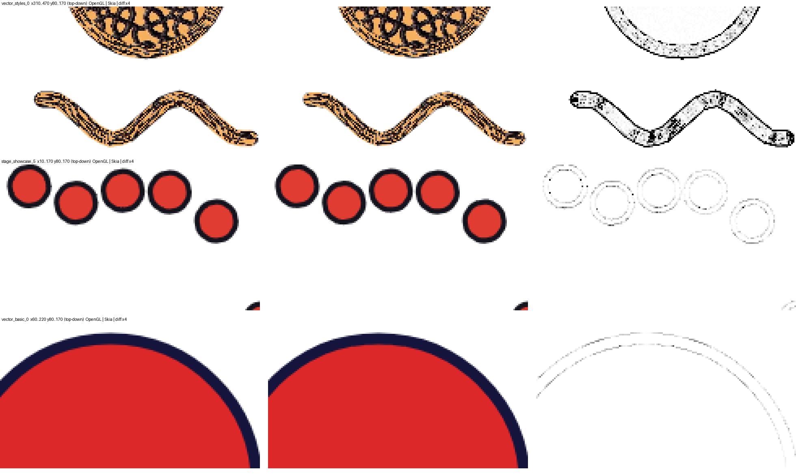

# 第 8 步对照图

摄影表画法（`ToonzScene::renderFrame`，场景图标、xsheet 缩略图、打印用的就是它），本机，640x360，叠在白底上。

- `step8_camstand.png`：六个场景各一帧。从左到右：OpenGL（默认）、Skia（`NEXTTOONZ_VECTOR_RASTERIZER=skia`，整帧没有 OpenGL 上下文）、两者之差（放大 4 倍，越黑差得越多）。最后一行是色指定栅格层，两边逐位相同，所以差值一片白。
- `step8_camstand_zoom.png`：差得最多的三块，放大 4 倍，左 OpenGL、中 Skia、右差值。

差别只在矢量的边上，和前几步看到的同一类：OpenGL 的平滑线镶边比 Skia 的精确覆盖率略宽、略软。`vector_styles` 差得最多，在贴图样式和几个有颗粒的笔触样式上，第 3 到 5 步的对照图里也是这样。位置、层次、颜色都一致。栅格层（png 和色指定）的结果两边逐位相同：合成本来就在 CPU 上做，只是最后一步从 `glDrawPixels` 换成了 `TRop::over`。

`particles_basic` 和 `checkerboard_camera` 的内容都是特效，摄影表画法本来就不画，两边都是空的，所以没有放进图里。

## 图

