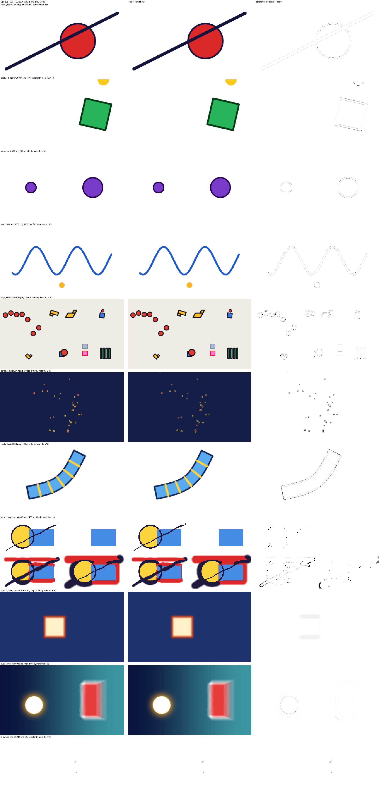

# 第 9 步对照图

默认切到 Skia 之后，golden 场景里所有被改变的场景，各取差得最多的一帧（320x180，放大 2 倍，叠在白底上）。从左到右：OpenGL（`NEXTTOONZ_VECTOR_RASTERIZER=gl`，即以前的基线画法）、Skia（现在的默认）、两者之差（放大 4 倍，越黑差得越多）。每行标题里是那一帧差超过 16 的像素数。

差别都在矢量的边上；`particles_basic` 的粒子是小的矢量精灵，差在每个点的边上；`fx_blur_over_colorcard`、`fx_gallery_cpu` 的差别来自特效输入里的矢量，被模糊放大成了淡淡的一圈。没有被 Skia 改变的场景（纯栅格、纯特效、字体、随机数、GLSL）不在图里，它们逐位不变。

## 图

